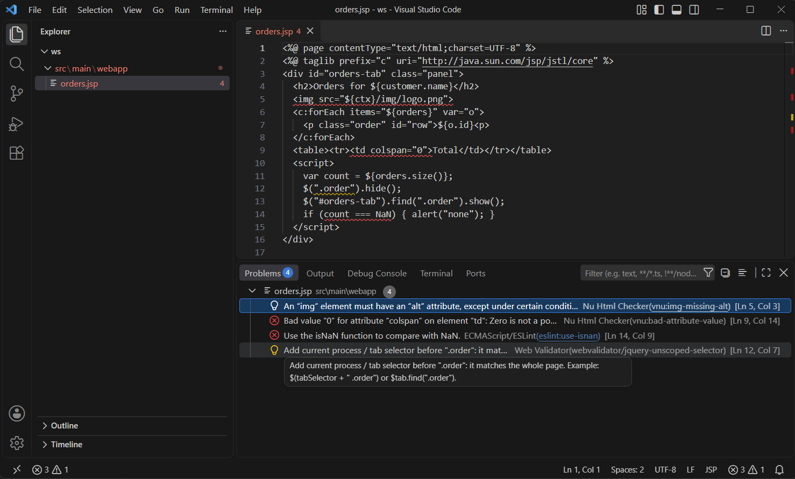

# Web Standards Validator for HTML & JSP

Validate HTML5, CSS, JavaScript and the HTML inside JSP pages as you work, with every
problem shown in the editor and the Problems panel. HTML and CSS checks are powered by the
**Nu Html Checker** (the engine behind validator.w3.org/nu), bundled with the extension and
run **on your machine**.

This extension is not affiliated with or endorsed by W3C.



## Features

- **HTML5 and CSS validation** with the Nu Html Checker, on open and save (or on demand).
- **JSP support**: scriptlets, EL and JSTL/custom tags are skipped, and the HTML around
  them is validated at the exact line and column of your `.jsp` file.
- **Fragments and includes**: SPA partials, `<jsp:include>` files and header/footer files
  validate cleanly without `<!DOCTYPE>`, `<html>`, `<head>` or `<body>`.
- **JavaScript checks** with ESLint: syntax errors and likely bugs in `.js` files and inline
  `<script>` blocks, plus a jQuery check for selectors that match the whole page instead of
  the current process/tab.
- **Your rules**: change severities or turn any rule off in `.webvalidator.json`, suppress
  single lines with comments, and add your own rules, in JSON or in JavaScript.
- **Quick fixes**: add `alt=""`, add `lang`, add a doctype, ESLint suggestions, and
  "Disable rule for this line / this file / in .webvalidator.json".
- **Validate Workspace**, **Validate Running Page** and a **rendered mode** for JSP that
  validates the page your running application serves.
- **Private by default**: nothing is sent over the network.

## Requirements

- **Java 17 or newer** for the HTML/CSS checks. The extension looks in
  `webValidator.java.home`, then `JAVA_HOME`, then `PATH`, then the JRE bundled with the
  [Red Hat Java extension](https://marketplace.visualstudio.com/items?itemName=redhat.java).
  Your projects can keep using another Java version (e.g. Java 8); only the validator needs 17+.
- Without Java, the JavaScript checks and custom rules still work and the status bar
  explains what is missing.

## Getting started

1. Install the extension and open a `.html`, `.jsp` or `.js` file.
2. Problems appear after the first save (the validator needs a few seconds to start the
   first time, then checks are fast).
3. Click the status bar item (bottom right) to see the log, or run
   **Web Validator: Validate Current File** from the Command Palette.
4. Run **Web Validator: Open Configuration File** to create a `.webvalidator.json` for your team.

## Rule ids

Every problem has a rule id, shown in the Problems panel:

| Prefix | Source | Example |
|---|---|---|
| `vnu:` | Nu Html Checker (HTML, CSS) | `vnu:img-missing-alt`, `vnu:css-invalid-value` |
| `eslint:` | ESLint core rules and syntax errors | `eslint:no-dupe-keys`, `eslint:syntax-error` |
| `webvalidator/` | Rules shipped with this extension | `webvalidator/jquery-unscoped-selector` |
| your own | Custom rules | `custom/no-inline-handlers` |

## Configuration: `.webvalidator.json`

Put a `.webvalidator.json` in your project (the nearest one above a file applies). Comments
and trailing commas are allowed, and VS Code autocompletes rule ids.

```jsonc
{
  "extends": ["recommended"],            // or "strict"
  "rules": {
    "vnu:missing-lang": "off",
    "vnu:obsolete-element": "warning",
    "vnu:css-*": "info",                  // wildcards
    "eslint:no-unused-vars": "warning",   // enable any ESLint core rule
    "eslint:eqeqeq": ["error", "smart"],  // with options
    "webvalidator/jquery-unscoped-selector": ["warning", { "allowContextArgument": true }]
  },
  "rulesDirectories": [".webvalidator/rules"],
  "jsp": { "customTagPrefixes": ["spring", "form"], "documentStructure": "ignore" },
  "ignoreMessages": ["^Section lacks heading"],
  "exclude": ["**/generated/**", "dist/**"],
  "customRules": [
    { "id": "custom/img-needs-alt", "selector": "img:not([alt])", "message": "Images need alt text", "severity": "error" }
  ]
}
```

- Severities: `"off"`, `"info"`, `"warning"`, `"error"` (ESLint-style `"warn"`, `0`, `1`, `2` also work).
- The same keys are available as settings (`webValidator.rules`, `webValidator.exclude`, …).
  Values in `.webvalidator.json` take precedence over settings.
- Problems in the file itself (unknown keys, invalid severities) are shown on the file.
- `strict` additionally enables `eslint:no-unused-vars`, `eslint:eqeqeq`, `eslint:no-var`,
  `webvalidator/no-inline-styles` and `webvalidator/require-button-type`.

## Suppressing problems with comments

Any comment syntax works (`<!-- -->`, `<%-- --%>`, `//`, `/* */`). List rule ids separated by
commas or spaces, or none for all rules; a reason may follow ` -- `.

```html
<!-- webvalidator-disable-next-line vnu:img-missing-alt -- decorative, alt set by script -->


<%-- webvalidator-disable vnu:obsolete-element --%>
<center>legacy block</center>
<%-- webvalidator-enable vnu:obsolete-element --%>

<script>
  $(".name").hide(); // webvalidator-disable-line webvalidator/jquery-unscoped-selector
</script>
```

`webvalidator-disable` without a matching `webvalidator-enable` applies to the rest of the
file. The quick fixes **Disable … for this line / this file** insert these comments for you.

## JSP files

`.jsp`, `.jspf` and `.tag` files are validated even if you associate them with the
`html` language. Before validation, JSP-only constructs are replaced with filler of the
same length, so every problem is reported at its exact line and column in your file:

| Construct | Replaced by |
|---|---|
| `<%-- --%>`, `<%@ %>`, `<%! %>`, `<% %>` | spaces |
| `<%= %>`, `${…}`, `#{…}` in an attribute value | a unique placeholder (`xxxa`), so the attribute stays non-empty |
| `<%= %>`, `${…}`, `#{…}` in text | a placeholder where text is allowed (`<title>`, `<td>`…), spaces elsewhere |
| `<%= %>`, `${…}` inside `<script>` | `0` followed by spaces, so `var n = ${count};` stays valid JavaScript |
| Custom tags (`<c:forEach>`, `<fmt:message/>`, `<jsp:include/>`…) | the tag markup is removed, the body is validated |

All other HTML is validated exactly as written. Problems caused only by a placeholder,
such as `type="${t}"` being "a bad value" or `<label for="${id}">` pointing at no element,
are not reported.

### Document structure (`webValidator.jsp.documentStructure`)

Many JSPs are not complete pages: SPA partials loaded into an existing `<div>`,
`<jsp:include>` fragments, and header/footer files that open or close `<body>`.

- **`ignore` (default):** `<!DOCTYPE>`, `<html>`, `<head>` and `<body>` tags are skipped,
  and every JSP is validated as a fragment inside a hidden synthetic page. Missing doctype,
  title, `lang` and "no `<h1>`" problems are not reported. Everything inside those tags is
  still validated.
- **`validate`:** full pages are checked including their structure. Files without
  `<html>` or `<!DOCTYPE>` are still treated as fragments.

Custom tag prefixes come from `<%@ taglib prefix="…" %>` directives, `jsp:`, and
`webValidator.jsp.customTagPrefixes`.

### Rendered mode (`webValidator.jsp.mode`)

With `"rendered"`, saving a JSP fetches the page your running application serves for it
(`webValidator.jsp.renderedBaseUrl` + the file's path below `webValidator.jsp.webRoot`) and
validates the real HTML output. The JSP shows one summary problem; its quick fix
**Show rendered page** opens the fetched page with all problems. Files under `WEB-INF`
can't be fetched directly; validate a page that includes them instead.

### Known limitations

- **Conditional branches are all validated together** (masked mode). `<c:choose>`, `<c:if>`
  and `<% if %>` bodies are validated as if every branch were output, so markup that is
  valid only on one branch can be reported. Rendered mode shows what one request produced.
- **Includes are not resolved** (masked mode). Each file is validated on its own. An element
  opened in one file and closed in another (e.g. `<div class="wrapper">` in a header,
  `</div>` in the footer) is reported as unclosed in the first file and stray in the second.
- **EL inside `<style>`** is replaced with spaces; CSS errors on a line that contains EL are
  not reported.
- **HTML produced by EL or custom tags** (e.g. `${rowsHtml}`) is only visible in rendered mode.

## JavaScript checks

`.js` files and inline `<script>` blocks are parsed with ESLint (`webValidator.javascript.ecmaVersion`,
default `latest`). Reported by default: syntax errors (`eslint:syntax-error`) and a set of
likely-bug rules such as `eslint:no-dupe-keys`, `eslint:no-unreachable`, `eslint:use-isnan`
and `eslint:valid-typeof`. Stylistic rules and `no-undef`/`no-unused-vars` are off by default
because inline scripts share globals; enable any core rule as `eslint:<name>` in the config.
ESLint's own `// eslint-disable-line …` comments also work for these rules.

### jQuery: selectors scoped to the current process/tab

In single-page applications the same partial is often loaded into several tabs, so
`$(".name")` finds elements in **every** tab. The rule `webvalidator/jquery-unscoped-selector`
(default `warning`) reports such selectors:

> Add current process / tab selector before ".name": it matches the whole page.
> Example: $(tabSelector + " .name") or $tab.find(".name").

| Reported | Not reported |
|---|---|
| `$(".name")`, `jQuery(".name")` | `$(tabSelector + " .name")` (starts with a variable) |
| `$("input")`, `$("[name=x]")`, `$(":checked")` | `` $(`${tab} .name`) `` |
| `$(".row-" + id)`, `` $(`.row-${id}`) `` | `$tab.find(".name")`, `$(this).find(".name")` |
| `$(".name", $tab)` (unless `allowContextArgument`) | `$("#saveBtn")`, `$("#" + id)` (starts with an `#id`) |
| `$(document).find(".name")`, `$("body").find(".name")` | `$("<div>")`, `$("body")`, `$(document)`, `$(el)` |
| `$("#a, .b")` (the `.b` part) | JSP: `$("${tabSel} .name")`, `$("<%= sel %> .name")` |

Options: `{ "allowContextArgument": true }` accepts `$(".name", $tab)`;
`{ "functionNames": ["$", "jQuery", "$j"] }` changes the jQuery names. Turn it off with
`"webvalidator/jquery-unscoped-selector": "off"`.

Not detected: selectors held in variables (`var s = ".name"; $(s)`), and delegated events
bound page-wide (`$(document).on("click", ".name", …)`).

## Custom rules

### Without code: JSON rules

Add `customRules` to `.webvalidator.json` (or the `webValidator.customRules` setting):

```json
{
  "customRules": [
    { "id": "custom/button-type", "selector": "form button:not([type])", "message": "Give buttons in forms a type" },
    { "id": "custom/no-legacy-api", "pattern": "OldApi\\.call\\(", "message": "Use NewApi instead", "languages": ["javascript", "jsp"] }
  ]
}
```

- `selector`: a CSS selector matched against elements. Supported: tags, `*`, `#id`,
  `.class`, `[attr]`, `[attr=v]`, `[attr~=v]`, `[attr^=v]`, `[attr$=v]`, `[attr*=v]`,
  `[attr|=v]` (add ` i` for case-insensitive), `:not(…)`, `:first-child`, `:last-child`,
  `:empty`, descendant and `>` combinators, and `a, b` lists.
- `pattern`: a regular expression matched against the file text (`flags` e.g. `"i"`).
  Pattern rules run only in trusted workspaces.
- Optional: `severity` (default `warning`), `languages` (default `["html", "jsp"]`), `docsUrl`.

### With code: rule files

Run **Web Validator: Create Custom Rule**. It creates `.webvalidator/rules/<name>.js` with a
commented example, a `webvalidator.d.ts` for IntelliSense, and registers both in
`.webvalidator.json`. Rules reload when you save them.

```js
// .webvalidator/rules/no-inline-handlers.js
/** @param {import("./webvalidator").RuleModule} rule */
const defineRule = (rule) => rule;

module.exports = defineRule({
  id: "custom/no-inline-handlers",
  languages: ["html", "jsp"],
  meta: { description: "Use addEventListener instead of on* attributes", defaultSeverity: "warning" },
  create(ctx) {
    return {
      element(el) {
        for (const name of Object.keys(el.attrs)) {
          if (name.startsWith("on")) ctx.report({ node: el, attribute: name, message: `Move ${name} into a script` });
        }
      },
    };
  },
});
```

- Files: `.js` / `.cjs` (CommonJS) or `.mjs` (ES module, `export default`). A file may export
  one rule, an array of rules, or `{ rules: [...] }`. TypeScript must be compiled first.
- `create(ctx)` returns visitors: `element(el)`, `text(node)`, `comment(node)`,
  `script(script)` (inline scripts and `.js` files; `script.ast` is an ESTree program),
  and `end()`.
- `el` has `tagName`, `attrs`, `parent`, `children`, `textContent`, `startTag`, `endTag`,
  `range` and `attrRanges`. In JSP files elements come from the masked page, so positions
  match your file.
- `ctx` has `text`, `language`, `options` (from `"rules": { "id": ["warning", {…}] }`),
  `elements`, `querySelectorAll(selector)`, `positionAt`, `offsetAt` and
  `report({ message, node | attribute | range | loc | offset+length, severity, fix, suggestions })`.
  A `fix` (`{ title, edits: [{ range, newText }] }`) becomes a quick fix.
- A rule that throws is reported once as `webvalidator/rule-error` (details in the output);
  other rules keep working.

### Rule packs

npm packages named `webvalidator-rules-*` (or `@scope/webvalidator-rules-*`) listed in your
workspace `package.json` are loaded automatically. A pack exports its rules like a rule file.

### Workspace trust

Rule files and rule packs are JavaScript that runs inside VS Code, so they are only loaded in
[trusted workspaces](https://code.visualstudio.com/docs/editor/workspace-trust). In untrusted
workspaces the built-in checks and selector-based JSON rules still run.

## Validate the workspace and running pages

- **Web Validator: Validate Workspace** checks every supported file (respecting
  `files.exclude`, `exclude` and `node_modules`), with progress and cancellation. Results stay
  in the Problems panel; **Clear Workspace Problems** removes them.
- **Web Validator: Validate Running Page…** fetches a URL from your local application and
  validates the returned HTML in a read-only document. Non-local addresses need confirmation.

## Settings

| Setting | Default | Description |
|---|---|---|
| `webValidator.enable` | `true` | Turn validation on or off. |
| `webValidator.run` | `onSave` | `onSave`, `onType` (debounced) or `manual`. |
| `webValidator.onTypeDelayMs` | `800` | Debounce delay for `onType`. |
| `webValidator.languages` | `html`, `jsp`, `javascript` | Language ids to validate. |
| `webValidator.maxFileSizeKb` | `1024` | Larger files are skipped. |
| `webValidator.rules` | `{}` | Rule severities by id (see Configuration). |
| `webValidator.ignoreMessages` | `[]` | Regular expressions of messages to hide. |
| `webValidator.exclude` | `[]` | Glob patterns of files not to validate. |
| `webValidator.customRules` | `[]` | JSON rules (see Custom rules). |
| `webValidator.rulesDirectories` | `[]` | Folders with custom rule files (trusted workspaces). |
| `webValidator.java.home` | | Java 17+ home folder or `java` executable. |
| `webValidator.vnu.mode` | `local` | `local` (bundled checker) or `server` (your own checker server). |
| `webValidator.vnu.serverUrl` | | Self-hosted Nu Html Checker URL, used in `server` mode. |
| `webValidator.vnu.validateOnType` | `false` | Also run the HTML checker while typing. |
| `webValidator.vnu.timeoutMs` | `20000` | Timeout for one HTML check. |
| `webValidator.jsp.documentStructure` | `ignore` | `ignore` or `validate` `<!DOCTYPE>`/`<html>`/`<head>`/`<body>` in JSP. |
| `webValidator.jsp.customTagPrefixes` | `c`, `fmt`, `fn`, … | Extra custom tag prefixes (taglib prefixes are detected automatically). |
| `webValidator.jsp.mode` | `masked` | `masked` (source file) or `rendered` (running application). |
| `webValidator.jsp.renderedBaseUrl` | | Base URL of the running application, e.g. `http://localhost:8080/app`. |
| `webValidator.jsp.webRoot` | `src/main/webapp` | Folder that maps to the base URL. |
| `webValidator.javascript.ecmaVersion` | `latest` | ECMAScript version used to parse JavaScript. |
| `webValidator.trace` | `info` | Log level of the **Web Validator** output channel. |

## Commands

- **Web Validator: Validate Current File**
- **Web Validator: Validate Workspace** / **Clear Workspace Problems**
- **Web Validator: Validate Running Page…** / **Show Rendered Page**
- **Web Validator: Open Configuration File**
- **Web Validator: Create Custom Rule**
- **Web Validator: Restart Validation Engines** (after installing Java or changing its path)
- **Web Validator: Show Output**

## Privacy

All validation runs locally. The HTML checker runs as a process on your computer that
only accepts connections from `127.0.0.1`; your code is never sent anywhere. Network requests
happen only when you ask for them: `webValidator.vnu.mode: "server"` sends documents to the
server you configure, and **Validate Running Page** / rendered mode request pages from the
URL you give (by default your local application). The extension collects no telemetry.

In [untrusted workspaces](https://code.visualstudio.com/docs/editor/workspace-trust),
custom rule code and pattern rules are not run, and workspace values for
`webValidator.java.home`, `webValidator.vnu.serverUrl`, `webValidator.rulesDirectories` and
`webValidator.jsp.renderedBaseUrl` are ignored.

## License

[MIT](LICENSE). The bundled Nu Html Checker and JavaScript libraries are covered by their
own licenses; see [THIRD_PARTY_NOTICES.md](THIRD_PARTY_NOTICES.md).
